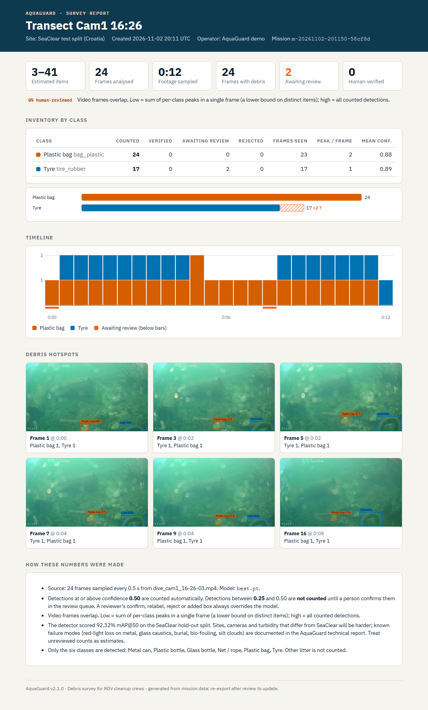
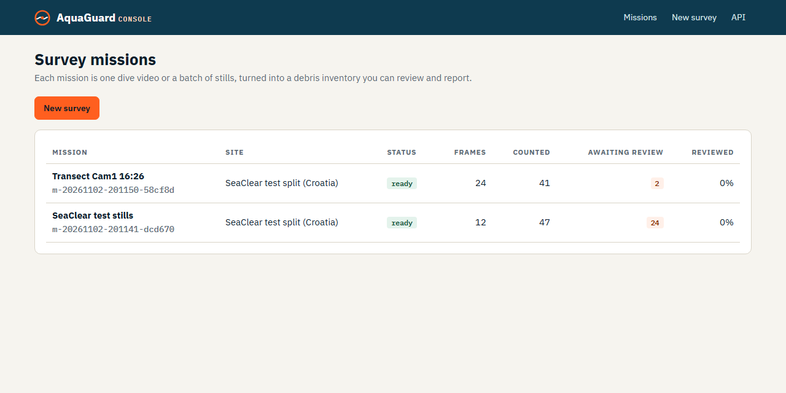
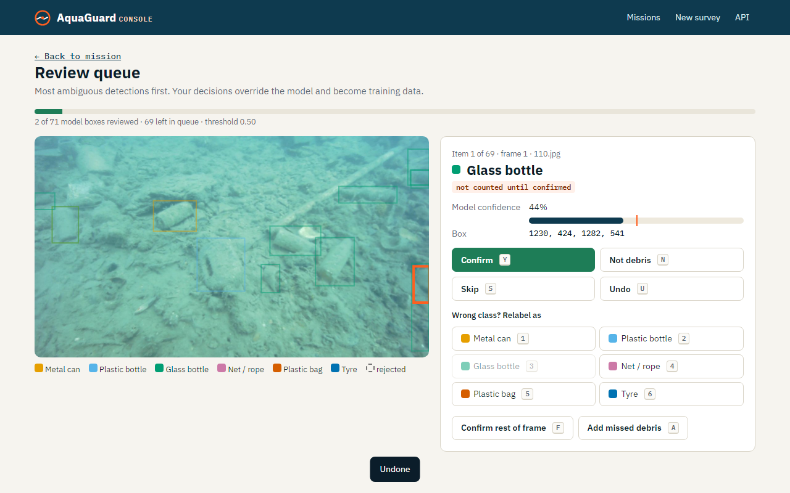
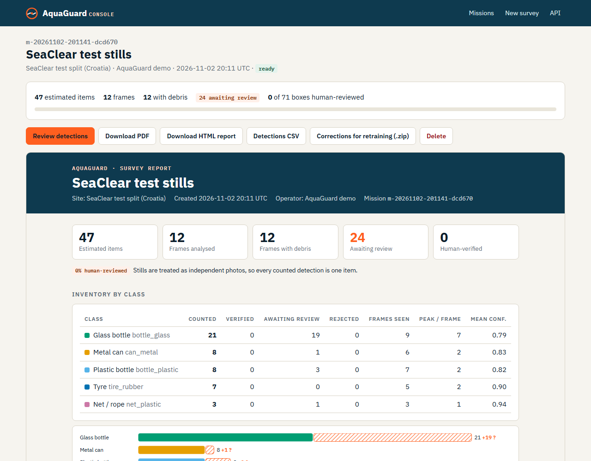
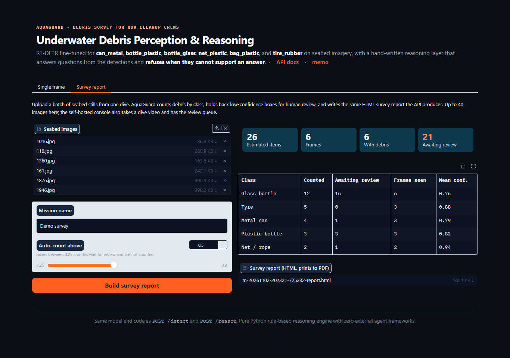

<div align="center">

# AquaGuard

### Debris survey for ROV cleanup crews

Upload a dive video or a batch of seabed stills. AquaGuard counts tyres, nets, bottles, cans and bags frame by frame, sends the uncertain boxes to a person for a yes or no, and gives you a survey report plus a corrections file for retraining.

[](https://huggingface.co/spaces/MrPhantom07/aquaguard)
[](.github/workflows/ci.yml)
[](memo/TECHNICAL_REPORT.md)

[Product brief](docs/PRODUCT.md) · [Demo script](DEMO.md) · [API guide](API_USAGE.md) · [Technical report](memo/TECHNICAL_REPORT.md)

</div>



*A real survey report. It was built from 24 frames sampled from a SeaClear test-split clip and run on CPU tonight. The range "3–41" is explained below.*

---

## What it does

| | |
| :--- | :--- |
| **1. Mission reports** | One dive is one mission. A video is sampled every *N* seconds; stills are used as they are. You get an inventory by class, a per-frame timeline, the busiest frames with boxes drawn, and the counting rules, as a single HTML file (it prints to A4) or a PDF. A CSV of every box is also available. |
| **2. Review queue** | Boxes below the auto-count threshold (default 0.50) are **not counted** until a person confirms them. The queue shows the most ambiguous boxes first. Keys: <kbd>Y</kbd> confirm, <kbd>N</kbd> not debris, <kbd>1</kbd> to <kbd>6</kbd> relabel, <kbd>A</kbd> draw a missed item, <kbd>F</kbd> accept the rest of the frame, <kbd>U</kbd> undo. `corrections.zip` holds a JSONL file with what the model said and what the reviewer said, plus YOLO labels and images for the fully reviewed frames. |
| **3. Secured API** | The REST API gets API keys (`AQUAGUARD_API_KEYS`) and a per-key token-bucket rate limit (`AQUAGUARD_RATE_LIMIT`, default `60/minute`) with `X-RateLimit-*` and `Retry-After` headers. With auth off, every response carries `X-AquaGuard-Auth: disabled`. |

The single-frame **reasoning assistant** is still there: ask "How many plastic bottles?" or "Where is the net?". It answers from the detections and refuses when they can't support an answer.

| Console: missions | Review queue | Mission page with the report |
| :---: | :---: | :---: |
|  |  |  |

### How the counting works

- `conf ≥ 0.50`: counted automatically. `0.25 ≤ conf < 0.50`: waits for review and is not counted. Below 0.25: dropped. All three thresholds can be set per mission.
- A reviewer's decision (confirm, relabel, reject, or an added box) always overrides the model. Model output and decisions are stored separately, so the report can be re-issued after review.
- **Video gives a range, not one number.** The ROV sees the same tyre in many consecutive frames, and AquaGuard has no object tracking yet. The lower bound is the per-class peak in any single frame. The upper bound is all counted detections. Stills are treated as independent photos.

---

## Quickstart

```bash
pip install -r requirements.txt
python -m uvicorn app.main:app --port 8000
# open http://localhost:8000/console  (landing page at /, OpenAPI at /docs)
```

Turn on keys and a rate limit for anything that isn't your own laptop:

```bash
export AQUAGUARD_API_KEYS="deck-1-key,analyst-key"     # comma-separated; unset = auth off
export AQUAGUARD_RATE_LIMIT="60/minute"                # or "off"
export AQUAGUARD_MISSIONS_DIR=/data/missions           # default ./missions
```

**No server (on the boat):**

```bash
python scripts/mission_report.py dive.mp4 --name "Harbour wall T3" --site "Pier 4" --every 2 --pdf
python scripts/mission_report.py stills/ --name "Lokrum stills"
```

The CLI writes into the same `missions/` folder, so you can review the mission in the console later. A mission is a plain folder (`mission.json` plus JPEG frames) that you can copy to a USB stick.

---

## Accuracy and speed, honestly

**Benchmark (SeaClear hold-out split: 858 images, 1,395 boxes).** The numbers come from [`eval_results/audit_metrics.json`](eval_results/audit_metrics.json) and the [technical report](memo/TECHNICAL_REPORT.md).

| mAP@50 | mAP@50:95 | Precision | Recall | GPU latency |
| :---: | :---: | :---: | :---: | :---: |
| **92.32%** | **69.62%** | **88.96%** | **87.52%** | **15.7 ms / image** |

| Class | mAP@50 | mAP@50:95 |
| :--- | :---: | :---: |
| Plastic bag (`bag_plastic`) | 99.2% | 78.8% |
| Tyre (`tire_rubber`) | 97.7% | 83.9% |
| Plastic bottle (`bottle_plastic`) | 93.5% | 68.3% |
| Net / rope (`net_plastic`) | 91.5% | 70.2% |
| Metal can (`can_metal`) | 88.6% | 59.0% |
| Glass bottle (`bottle_glass`) | 83.6% | 57.4% |

**What the numbers don't tell you.** The split is **per image**, not per dive (see section 2.2 of the technical report: a dive-level split left no nets in training). Neighbouring frames of the same clip therefore appear in both training and test, so these scores are optimistic for a new site, camera or water type. This is the reason review is built into the workflow rather than offered as an extra. Glass bottles and metal cans are the weakest classes, and in the sample missions most of the "awaiting review" boxes were glass bottles. The five documented failure modes (red-light loss on metal, glass caustics, burial, bio-fouling, silt clouds) are covered in the [technical report](memo/TECHNICAL_REPORT.md).

**CPU latency (measured).** This is `python scripts/cpu_latency.py`: the same `model.predict` call `/detect` makes, `device="cpu"`, 4 torch threads, 2 warm-up runs and 10 timed runs per image, on the three validation mosaics in `memo/assets/`.

| Image | Size | Wall median (ms) | Wall p95 (ms) | Pre / Infer / Post median (ms) |
|---|---|---|---|---|
| val_batch0_labels.jpg | 1920x1920 | 326 | 459 | 1.9 / 294 / 0.3 |
| val_batch1_labels.jpg | 1920x1920 | 366 | 411 | 1.9 / 332 / 0.3 |
| val_batch2_labels.jpg | 1920x1920 | 314 | 432 | 1.8 / 282 / 0.3 |

**Mission throughput (measured, 2026-11-03).** `scripts/mission_report.py` ran on CPU with 4 threads and batches of 8 frames:

- 12 test-split stills took 5.3 s (0.44 s per frame).
- 24 frames sampled from a 12 s test-split clip took 8.3 s (0.35 s per frame).

Both times include decoding, downscaling and saving the frames. The machine is an AMD Zen 4 laptop CPU (16 logical cores, 4 used) with torch 2.11 and ultralytics 8.4.112. Other jobs were running at the same time, so treat the figures as rough.

---

## API

| Method | Route | What it does |
| :--- | :--- | :--- |
| `GET` | `/health` | Service, model and auth status (public) |
| `POST` | `/api/v1/detect` | Boxes for one image (`file`, `conf`) |
| `POST` | `/api/v1/reason` | Grounded answer about one image (`file`, `question`, `conf`) |
| `POST` | `/api/v1/missions` | Start a mission: `files` (one video or up to 300 images), `name`, `site`, `operator`, `conf`, `floor`, `every_s`, `max_frames`. Returns **202**; poll until `status` is `ready` |
| `GET` | `/api/v1/missions[/{id}]` | List missions, or one mission with its inventory (`?frames=true` adds the boxes) |
| `GET` | `/api/v1/missions/{id}/report.html` · `report.pdf` · `detections.csv` | Reports and exports |
| `GET` | `/api/v1/missions/{id}/review/queue` | Undecided boxes, most ambiguous first |
| `POST` | `/api/v1/missions/{id}/review` | `{"detection_id", "action": confirm/reject/relabel/undo, "class_name"?, "reviewer"?}` |
| `POST` | `/api/v1/missions/{id}/frames/{i}/confirm` · `/boxes` | Accept the rest of a frame, or add a missed box |
| `GET` | `/api/v1/missions/{id}/corrections.zip` · `.jsonl` | Retraining export |

`/detect`, `/reason` and `/health` are also served without the `/api/v1` prefix for older clients. Errors are RFC 7807 problem documents. Send keys as `X-API-Key: <key>` or `Authorization: Bearer <key>`. Mission creation costs 10 rate-limit tokens, a PDF 2, review clicks 0.1. Examples are in [`API_USAGE.md`](API_USAGE.md).

### Reasoning guardrails (single frame)

The reasoning layer is plain Python ([`app/reasoning.py`](app/reasoning.py)), with no LLM and no agent framework.
- **Intent routing:** greetings and capability questions are answered without running the detector.
- **Class grounding:** "plastic bottles" means `bottle_plastic`, not every bottle. "Is there a tyre?" answers **No** when only cans were seen.
- **Refusals:** questions about depth, weight, brand or temperature, and questions where every detection is below `conf`, get "Insufficient information …" rather than a guess.

---

## Live demo

The [Hugging Face Space](https://huggingface.co/spaces/MrPhantom07/aquaguard) runs the Gradio studio (`app_ui.py`). On this branch the studio also has a **Survey report** tab: upload up to 40 stills and download the same HTML report the API produces. **The live Space has not been redeployed with this branch yet**, so today it shows the single-frame studio only. The console, review queue and API keys are part of the self-hosted API, not the Space.



```bash
pip install -r requirements-space.txt    # core deps + gradio 6.15.1 (the Space's version)
python app_ui.py                         # http://localhost:7860
```

A walk-through for a live demo is in **[DEMO.md](DEMO.md)**.

---

## Deploy

```bash
docker compose up          # API on :8000 (console at /console) + Gradio studio on :7860
```

`docker-compose.yml` passes `AQUAGUARD_API_KEYS` and `AQUAGUARD_RATE_LIMIT` from your shell or `.env` and mounts `./missions`. The image runs **one** uvicorn worker on purpose. The mission worker, the per-mission edit locks and the rate limiter all live in-process, so scaling out would need a job queue and a shared limiter (for example Redis). The API refuses bodies over `AQUAGUARD_MAX_UPLOAD_MB` (default 512) before parsing them, and checks keys and the rate limit before reading the body. If you put a reverse proxy in front, give it the same body limit (nginx: `client_max_body_size 512m;`) and list it in `AQUAGUARD_TRUSTED_PROXIES` so the rate limit sees real client IPs. GPU variant: `docker-compose.gpu.yml`.

## Tests

```bash
python -m pytest -m "not integration" -q   # mocked detector: no weights, no GPU (what CI runs)
python -m pytest -q                        # + end-to-end against weights/best.pt
```

The mission, review, report, security and API tests use a fake detector, so they need no model. CI runs them on CPU-only PyTorch.

## Repository layout

```
app/
  main.py          FastAPI app: /detect, /reason, health, landing page, API-key + rate-limit dependency
  missions_api.py  /api/v1/missions: upload, background processing, reports, review, exports, /console
  mission.py       Frames -> inventory: counting rule, video sampling, review queue order, estimates
  review.py        Confirm / reject / relabel / add box; corrections.jsonl + YOLO export
  report.py        Self-contained HTML report (inline SVG charts) and matplotlib PDF
  security.py      API keys (constant-time compare) and token-bucket rate limiter
  store.py         File-backed mission storage (missions/<id>/mission.json + frames/)
  brand.py         Palette, colour-blind-safe class colours, box drawing
  reasoning.py     Single-frame intent routing, class grounding, guardrails
  web/             index.html (landing) and console.html (operator console)
app_ui.py          Gradio studio (HF Space): single frame + Survey report tab
scripts/           mission_report.py (offline CLI), cpu_latency.py, training/eval/data prep, deploy_to_hf.py
tests/             Unit + API tests with a fake detector; test_api.py hits the real weights (integration)
docs/              PRODUCT.md (brief) and screenshots
memo/              TECHNICAL_REPORT.md and training curves
weights/best.pt    Fine-tuned RT-DETR-L checkpoint
```

## Data and credits

The detector is RT-DETR-L ([Ultralytics](https://github.com/ultralytics/ultralytics)), fine-tuned on the **SeaClear Marine Debris dataset** (4TU.ResearchData, described in *Scientific Data*). It covers five sites in Croatia and France and three camera types. The sample frames in the screenshots come from that dataset's test split. The repository does not currently include a licence file.
